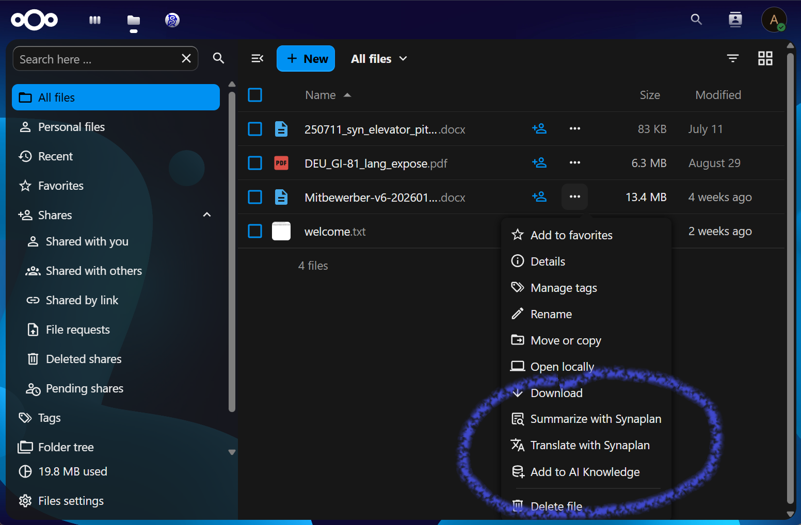

# Synaplan Integration for Nextcloud



AI-powered document summarization, translation, knowledge base, and research chat — directly in Nextcloud.

## Features

- **Summarize** — Generate document summaries from the file context menu (bullet points, paragraph, or abstractive; adjustable length and output language). Results are rendered as formatted Markdown.
- **Translate** — Translate files to multiple languages via the file context menu, with the result rendered as Markdown.
- **Add to Knowledge** — Upload files to the Synaplan AI knowledge base for RAG-powered search and chat, with group management and a staged upload progress view.
- **Research Chat** — AI assistant (full-page view **and** a floating in-page launcher) with knowledge-group selection, model picker, streaming answers, and Markdown rendering. The `/pic` and `/vid` commands generate images and videos when the corresponding models are configured. Requests run through Synaplan's **multi-task (DAG) routing** on the connected instance, so a single complex prompt can be decomposed server-side into several steps (e.g. *search knowledge → summarize → generate*) instead of one flat answer.

### Language handling

- Set a **default answer language** in the admin settings.
- Optionally **follow each user's Nextcloud interface language** automatically, falling back to the default when a language isn't supported.
- The resolved language applies to chat answers, summaries, and translations — no more "always English".

### Personalisation & live feedback

- **Personal memories** — when Synaplan's memory service (Qdrant) is available and enabled by the admin, the chat can enrich answers with the user's memories (toggle in the chat).
- **Live status** — the chat shows the active model, answer language, image/video availability, the selected knowledge base, and memory state, and mirrors Synaplan's routing pipeline as staged progress (*sorting → searching → generating*) while the answer is prepared.
- **Real streaming** — answers stream token-by-token rather than appearing all at once.

### Supported File Types

| Type | Formats |
|------|---------|
| Text | TXT, Markdown, CSV, HTML, XML, RTF, JSON |
| Documents | PDF, DOCX, DOC, ODT |
| Spreadsheets | XLSX, XLS, ODS |
| Presentations | PPTX, PPT, ODP |

Binary formats (PDF, Office, OpenDocument) are processed via Synaplan's built-in Tika text extraction.

## Requirements

- Nextcloud 33–35
- PHP 8.2+
- A running [Synaplan](https://synaplan.com) instance with a valid API key

## Installation

### From the Nextcloud App Store (recommended)

1. Go to your Nextcloud instance → **Apps**
2. Search for **Synaplan Integration**
3. Click **Download and enable**

### From a Release Tarball

```bash
# Download the latest release
wget https://github.com/metadist/synaplan-nextcloud/releases/latest/download/synaplan_integration.tar.gz

# Extract into Nextcloud's custom_apps directory
tar -xzf synaplan_integration.tar.gz -C /path/to/nextcloud/custom_apps/

# Enable the app
php /path/to/nextcloud/occ app:enable synaplan_integration
```

### From Source (Development)

```bash
git clone https://github.com/metadist/synaplan-nextcloud.git
cd synaplan-nextcloud

composer install
npm install
npm run build

# Symlink into Nextcloud
ln -s "$(pwd)" /path/to/nextcloud/custom_apps/synaplan_integration

php /path/to/nextcloud/occ app:enable synaplan_integration
```

## Configuration

1. Go to **Admin Settings** → **Synaplan Integration**
2. Enter your Synaplan instance URL (e.g., `https://synaplan.example.com`)
3. Enter your Synaplan API key
4. Click **Test connection** to verify

### Language & AI behaviour (admin)

- **Default answer language** — the language the AI replies in by default.
- **Use each user's Nextcloud interface language when supported** — when enabled, answers follow the signed-in user's interface language and fall back to the default otherwise.
- **Allow personal memories in chat** — lets users enrich answers with their Synaplan memories (requires the memory service, Qdrant, to be available in Synaplan).

## Development

```bash
composer install          # PHP dependencies
npm install               # JS dependencies

make ci-local             # Every CI job except e2e — run before each push
make lint                 # php-cs-fixer, ESLint, Prettier
make stan                 # PHPStan
make test                 # PHPUnit
make test-contract        # Every call to Synaplan against the pinned Synaplan's OpenAPI spec (Docker)
make typecheck            # vue-tsc
make test-unit-js         # Vitest
make test-e2e             # Playwright journeys (see End-to-end journeys)
make build                # Production frontend build
make help                 # Show all available commands

npm run dev               # Watch mode (auto-rebuild on changes)
```

### Local Nextcloud next to Synaplan (WSL)

Start the Synaplan stack with Keycloak first (`docker compose --profile oidc up -d`
in `../synaplan`), then:

```bash
make dev-up        # copies docker-compose.dev.yml.example (gitignored) on the first run
```

The first run builds the frontend when `js/` is missing (that directory is not in
git). A later `make dev-up` leaves an existing build alone.

- Nextcloud: http://localhost:8081 — `admin` / `admin`; the test people `ada`,
  `bob` and `carol` (password `<name>-dev-pass`). Ada has the folders the
  journeys use; `Incoming-DE` (edit) and `Specs` (read) are shared with Bob.
- Organisation login: the Keycloak button on the login page. Keycloak's `ada`
  (`ada-dev-pass`) signs in as the local `ada`. `NC_OIDC=0 make dev-reset dev-up`
  installs without it.
- Version: `nextcloud:35-apache` by default; `NC_IMAGE=nextcloud:33-apache make dev-reset dev-up`
  for the floor (a major version change needs fresh volumes).
- MariaDB on a private network, system cron (`nextcloud-cron`), mail to
  Synaplan's MailHog (http://localhost:8025).
- The app is mounted from this repo and preconfigured for the local stack: it
  calls Synaplan at `http://backend` and sends browsers to http://localhost:5173.
- Three modes: **shared** key, **provision** (create an account per user), and
  **link** (each person connects their existing Synaplan account). Synaplan
  must have Linked platforms enabled (`PLATFORM_LINKS.ENABLED`) for `link`.
- Ready check: `../synaplan/_devextras/testing/cloud-apps/env-check.sh --cloud nextcloud --oidc`.

`make dev-down` stops the stack and keeps the volumes; `make dev-reset` deletes
them. `make dev-occ CMD="user:list"`, `make dev-logs` and `make dev-shell` help
while it runs.

### End-to-end journeys (Playwright)

The journeys in `tests/e2e` click through a real Nextcloud next to the Synaplan
test stack: connect an account, Summarize, Translate, Chat about this file,
Make searchable by AI, save a generated image, disconnect on either side, and
accounts created by the administrator. CI runs them on Nextcloud 33 and 35.

```bash
npx playwright install chromium   # once
make e2e-up       # Synaplan test stack on :8001 (pinned image, files from ../synaplan), Nextcloud on :8091
make test-e2e     # the journeys, in order, with one browser
make e2e-down     # stop both stacks and delete their data
```

- `NC_IMAGE=nextcloud:33-apache make e2e-up` starts the floor; `E2E_NC_PORT`
  moves Nextcloud, `SYNAPLAN_DIR` points at another synaplan checkout.
- The setup resets the test people, so `make test-e2e` runs again on the same
  stacks.
- A host port of the Synaplan test stack already taken (3308, 11434, …): put a
  compose file that drops it in `E2E_SYNAPLAN_FILES`.

## Release

Releases come from CI (`.github/workflows/release.yml`):

1. A pull request sets the version in `appinfo/info.xml` and `package.json`
   and dates its `CHANGELOG.md` section (`## 1.7.0 – 2026-10-20`). The
   workflow's dry run checks that the three agree, packages, and signs with a
   throwaway key.
2. After the merge, and once **All Checks Passed** is green on `main`, tag the
   merge commit: `git tag v1.7.0 && git push origin v1.7.0`.
3. The workflow refuses a tag that is not on `main` or whose CI run failed,
   and an `info.xml` the App Store schema rejects (`scripts/check-info-xml.sh`).
   It packages, signs, verifies the signature against the certificate the App
   Store holds for the app, attaches the tarball and its signature to a GitHub
   release and publishes the release to the App Store.

`v1.7.0-rc.1` stops at a draft GitHub release, for a test install before the
release. Running the workflow again for a tag reuses the files its release
already holds, so the App Store's signature keeps matching. The workflow
needs two repository secrets: `APP_STORE_SIGNING_KEY`
(the app's private key) and `APP_STORE_TOKEN` (an App Store API token of an
owner or co-maintainer).

By hand, with the key in `~/.nextcloud/certificates/`:

```bash
make package              # Build unsigned tarball
make sign                 # Build + sign (requires certificate)
make appstore             # Build, sign, and show upload instructions
```

## License

Apache-2.0 — see [LICENSE](LICENSE).
